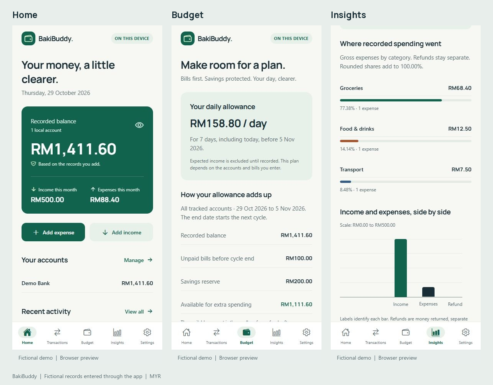
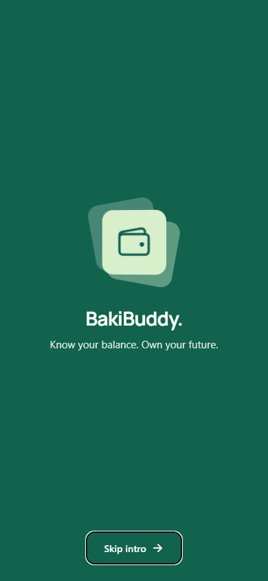
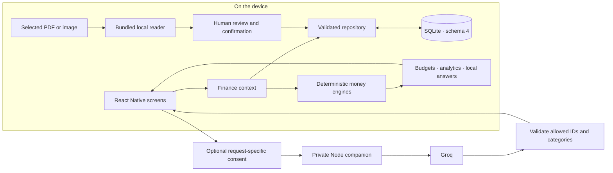
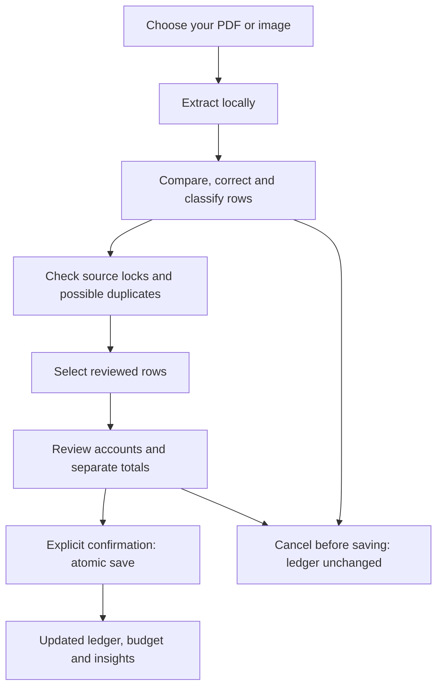

<p align="center">
  
</p>

<h1 align="center">BakiBuddy</h1>
<p align="center"><strong>Know your balance. Own your future.</strong></p>
<p align="center">A local-first personal finance app for Malaysian students and young adults.<br>Track your money, plan until payday, and review imports before anything is saved.</p>

<p align="center">
  
  
  
  
</p>

<p align="center"><a href="#demo">Demo</a> · <a href="#features">Features</a> · <a href="#tech-stack">Tech stack</a> · <a href="#quick-start">Quick start</a> · <a href="#architecture">Architecture</a> · <a href="#project-status">Status</a></p>

> [!NOTE]
> **Development preview · v0.8.1.** Android and iOS share one Expo codebase; web is a supplemental preview. Basic use needs no account, bank connection or AI key. Store distribution, real email sign-in and cloud sync are not implemented.

## Demo

These are **actual React Native Web captures with fictional records**, created in an isolated browser ledger. They are not native-device screenshots. A normal installation starts empty.



<p align="center"><a href="docs/media/home.jpg">Home</a> · <a href="docs/media/budget.jpg">Budget</a> · <a href="docs/media/insights.jpg">Insights</a> · <a href="docs/media/transactions.jpg">Transactions</a></p>

<details>
<summary>Watch the welcome animation</summary>

<p align="center"></p>

Recorded from the browser build. Open **Settings → Welcome & sign-in → Open login preview** to try it. The entrance offers Skip and Replay; reduced-motion preferences suppress it. Email/password entry and Sign in are unavailable. **Continue as guest** opens the existing local app.

</details>

The capture scenario and provenance are in [docs/media/README.md](docs/media/README.md).

## Why BakiBuddy?

A recorded balance alone does not explain how much is available until the next allowance or salary. BakiBuddy connects that balance to unpaid bills, savings reserves and an optional spending cap. Expected income stays conditional until it is actually recorded.

The defaults are **MYR** and **Asia/Kuala_Lumpur**. Money calculations use integer sen in deterministic code. AI can interpret a question or suggest a category; it never supplies authoritative financial arithmetic.

## Features

| Area | Implemented behavior |
| --- | --- |
| **Accounts & ledger** | Bank, eWallet, cash and other accounts; opening balances; income, expenses, refunds and tracked-account transfers; edit/delete, search and filters. Transfers do not inflate income or spending. |
| **Budget planning** | Weekly, monthly, custom and irregular cycles; bills, expected income, reserves and spending limits; daily allowances and conditional forecasts. |
| **Insights** | Date/account filters, daily/weekly/monthly spending, category shares, cash flow and budget utilization, with exact-value fallbacks. |
| **TNG PDF import** | Local reading of the verified text-based eWallet layout, including password-protected PDFs; editable classification, duplicate review and atomic confirmation. |
| **Receipt & screenshot OCR** | Bundled local recognition for supported printed-Latin/MYR images; source comparison, mandatory row review and duplicate protection. QR codes and points do not prove payments. |
| **Money assistant** | Bounded local questions and reviewed categorization. Optional Groq help requires an operation-specific data preview and consent. |
| **Data controls** | Reviewed JSON/CSV reference exports, guarded atomic local deletion, database integrity checks and a privacy notice. |

Read the detailed [budget](BUDGET_RULES.md), [analytics](ANALYTICS_RULES.md), [PDF import](IMPORT_RULES.md), [scanning](SCANNING_RULES.md) and [assistant](ASSISTANT_RULES.md) rules.

## Tech stack

| Layer | Technology | Purpose |
| --- | --- | --- |
| App | **Expo SDK 58.0.21**, **React Native 0.88**, **React 19.3** | Shared Android/iOS codebase and supplemental web rendering |
| Language & routing | **TypeScript 6**, strict mode; **Expo Router 58** | Typed application code and file-based routes |
| State & storage | React Context; **Expo SQLite**, schema **4** | Local snapshots, migrations and serialized atomic writes |
| UI & motion | **StyleSheet**, reusable tokens, Manrope, Expo icons; **Reanimated 4.7** | Consistent UI and finite wallet entrance |
| Charts | **React Native Gifted Charts** + React Native SVG | Render values computed by the analytics engine |
| Local readers | **PDF.js 6.4**, **Tesseract.js 7** | Bundled extraction/OCR through native WebView or web iframe bridges |
| Optional AI | **Node.js** companion; **Groq**, `openai/gpt-oss-20b` | Server-only provider key and constrained cloud operations |
| Verification | Node test runner, `node:sqlite`, Playwright, ESLint, Expo Doctor | Business/SQL/server tests, browser scenarios and compatibility checks |
| Package manager | **pnpm 11.25.0**, committed lockfile | Reproducible installation |

There is no Redux, hosted database or mandatory backend. The Groq-hosted model name does not require an OpenAI API key.

## Quick start

Use **Node 24.x (24.3+)** and **pnpm 11.25.0**. The package also supports Node 22.18+ and 26+. Install Expo Go compatible with SDK 58 on your phone.

```sh
git clone https://github.com/sean8911/bakibuddy.git
cd bakibuddy/bakibuddy

# If pnpm is not installed:
npm install --global pnpm@11.25.0

pnpm install --frozen-lockfile
pnpm start
```

The first `bakibuddy` is the cloned repository; the second is the Expo app directory.

1. Keep the computer and phone on a reachable local network.
2. Android: scan the terminal QR from Expo Go. iPhone: scan with Camera and open Expo Go; use the same Expo account on computer/phone when Expo Go requires it.
3. Add an account with its balance **before** the transactions you will record. Add a transaction, then create a budget plan.

Android emulation needs a configured emulator. The iOS Simulator needs macOS/Xcode. See the [development guide](docs/DEVELOPMENT.md) for troubleshooting, the isolation-header web preview, imports and device checks.

### Optional Groq assistant

Basic budgeting and local answers work without this service.

```sh
cd bakibuddy                 # from the repository root
pnpm ai:setup
# Edit server/.env locally: add GROQ_API_KEY and keep AI_SERVER_TOKEN private.
pnpm ai:server
```

Configure the companion URL and its separate server access token in the app. Every cloud operation still needs its own consent. Provider keys belong only in the ignored server environment file, never in Expo/public variables. Provider quotas and terms apply; see [Groq's documentation](https://console.groq.com/docs/overview) and the [setup guide](docs/DEVELOPMENT.md#optional-cloud-setup).

The companion is a private development service. Public hosting needs separate HTTPS, authentication and abuse-control work.

## Architecture



All balance, budget and analytics arithmetic stays in tested local code. Model output cannot create financial figures or silently write categories into the ledger.

### Import workflow



Statement passwords are used locally and are not persisted. Unsupported layouts and uncertain OCR fields need correction or rejection. No public TNG transaction API is assumed.

## Privacy & data boundaries

- Financial records are local. Import/OCR source files are not uploaded to an external recognition service.
- Optional AI requests disclose their operation/data before sending; local answers remain available without cloud access.
- JSON/CSV exports are **unencrypted reference copies**. Restore, automatic backup and sync are unavailable.
- The Expo Go ledger has **no app-managed encryption**. OS backups, external copies and source documents are outside in-app deletion.
- Only fictional test PDFs/images are committed. Secrets, ledgers, original statements and raw browser profiles are excluded.

See [data controls](DATA_CONTROLS_RULES.md), [security review](SECURITY_REVIEW.md) and the [draft privacy notice](PRIVACY_POLICY_DRAFT.md).

## Verification

Documented v0.8.1 checks include **192 passing automated tests**, typecheck/lint, Expo dependency/peer checks, Doctor **20/20**, and Android/iOS/web exports. These are local results, not a hosted CI badge or complete native acceptance.

From the app directory:

```sh
pnpm typecheck
pnpm lint
pnpm test
pnpm check:expo
pnpm exec expo export --platform all
```

Tests cover money/date boundaries, migrations, transaction semantics, rollback, budgets, analytics, import/scan validation, privacy operations and companion contracts. Browser commands are in the [development guide](docs/DEVELOPMENT.md#verification).

Full iPhone/Android safe-area, gesture, keyboard, large-text, assistive-technology and performance checks remain open. The dependency review retains one high and one low tooling advisory; [SECURITY_REVIEW.md](SECURITY_REVIEW.md) records their scope.

## Project layout

```text
bakibuddy/                 Expo app
  src/app/                 File-based routes
  src/components/          Reusable UI
  src/storage/             SQLite schema, repository and ledger derivation
  src/budget/              Calendar and budget engine
  src/analytics/           Exact totals, buckets and comparisons
  src/importing/           Local PDF extraction and reviewed imports
  src/scanning/            OCR bridge, candidates and duplicates
  src/assistant/           Deterministic facts and cloud contracts
  src/privacy/             Export formats and notices
  src/theme/               Canonical design tokens
  server/                  Optional private Groq companion
  tests/                   Tests and fictional fixtures
docs/                      Development guide and curated demo media
*_RULES.md                 Domain behavior and invariants
DESIGN.md                  Established design system
ROADMAP.md                 Scope and phase gates
```

## Project status

| Area | Status |
| --- | --- |
| Ledger, budgets and analytics | Implemented |
| Reviewed PDF/OCR import | Implemented for documented layouts |
| Local assistant and consented Groq operations | Implemented |
| Export, deletion and security/QA work | Implemented; native checklist open |
| Animated welcome/login preview | Implemented; real sign-in unavailable |
| Standalone/store distribution | Planned; no store build/submission |
| Authentication, sync and restore | Not implemented |

[ROADMAP.md](ROADMAP.md) and [PROGRESS.md](PROGRESS.md) record decisions and evidence. Publishing this source repository does not deploy the app or submit it to a store.

## Contributing & contact

Questions and reproducible bug reports are welcome through [GitHub Issues](https://github.com/sean8911/bakibuddy/issues). Use fictional records and remove credentials, statements, account identifiers and personal screenshots. Read [CONTRIBUTING.md](CONTRIBUTING.md) before changing the project.

Maintained by [@sean8911](https://github.com/sean8911).

## Licenses & notices

A separate project-wide license has not been selected. The Expo template's MIT notice is retained in [bakibuddy/LICENSE](bakibuddy/LICENSE). PDF.js and OCR assets retain their notices in [third-party/PDFJS-LICENSE](bakibuddy/third-party/PDFJS-LICENSE) and [assets/ocr/NOTICE.txt](bakibuddy/assets/ocr/NOTICE.txt). See [asset provenance](bakibuddy/assets/README.md) for the original wallet mark and unused template artwork.
