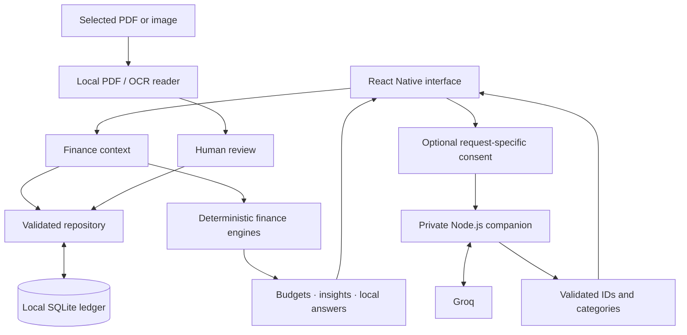
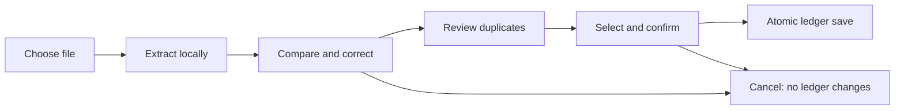

<p align="center">
  
</p>

<h1 align="center">BakiBuddy</h1>
<p align="center"><strong>Know your balance. Own your future.</strong></p>
<p align="center">Personal finance for Malaysian students and young adults.<br>Track everyday spending, plan until payday, and keep your records on your device.</p>

<p align="center">
  
  
  
  
</p>

<p align="center">
  <a href="#preview">Preview</a> ·
  <a href="#features">Features</a> ·
  <a href="#technology">Technology</a> ·
  <a href="#getting-started">Getting started</a> ·
  <a href="#architecture">Architecture</a> ·
  <a href="#documentation">Documentation</a>
</p>

## Overview

BakiBuddy turns a recorded balance into a practical spending plan. It combines accounts, upcoming bills, savings reserves, and income cycles to show how much is available until the next payday or allowance.

Built with React Native and Expo, the app shares one codebase across Android and iOS. Core tracking, budgeting, imports, and local assistant answers work without a BakiBuddy account or an AI service.

**Current version: 0.8.1 · Development preview.** The app runs through Expo Go; standalone distribution, real sign-in, cloud sync, and archive restore are not yet available.

## Preview


<p align="center">
  <a href="docs/media/home.jpg">Home</a> ·
  <a href="docs/media/budget.jpg">Budget</a> ·
  <a href="docs/media/insights.jpg">Insights</a> ·
  <a href="docs/media/transactions.jpg">Transactions</a>
</p>

*Actual browser captures of the app with fictional records. A new installation starts with an empty ledger.*

<details>
<summary><strong>Watch the animated welcome experience</strong></summary>

<p align="center"></p>

The welcome preview includes a branded wallet entrance, Skip, Replay, reduced-motion support, and guest access. Open **Settings → Welcome & sign-in → Open login preview** to try it. Email sign-in is currently unavailable.

</details>

## Features

| Feature | What it does |
| --- | --- |
| **Accounts and transactions** | Manage bank, cash, and eWallet balances. Record income, expenses, refunds, and transfers; search, filter, and edit the ledger. |
| **Budget planning** | Plan around income cycles, upcoming bills, savings reserves, and spending limits. View daily allowances and conditional income forecasts. |
| **Financial insights** | Explore spending trends, category breakdowns, cash flow, and budget utilization with date and account filters. |
| **Touch ’n Go imports** | Read supported text-based TNG eWallet PDFs locally, including password-protected statements. Review and classify rows before saving. |
| **Receipt and screenshot scanning** | Extract candidate transactions from supported printed-Latin/MYR images with local OCR. Compare, correct, and approve each selection. |
| **Money assistant** | Ask supported questions locally. Optional Groq requests can interpret questions or suggest categories after explicit consent. |
| **Data controls** | Export reviewed JSON/CSV reference copies, inspect privacy information, and delete local records through a guarded confirmation flow. |

Financial calculations use **integer sen**, with MYR and Asia/Kuala_Lumpur defaults. Tracked-account transfers stay separate from income and spending. AI output never supplies authoritative financial figures.

## Technology

| Layer | Stack |
| --- | --- |
| Application | Expo SDK **58**, React Native **0.88**, React **19.3** |
| Language and navigation | Strict TypeScript **6**, Expo Router |
| State and persistence | React Context, Expo SQLite, versioned migrations and atomic writes |
| Interface and motion | StyleSheet, shared design tokens, Manrope, Expo icons, Reanimated |
| Visualization | React Native Gifted Charts, React Native SVG |
| Local document processing | PDF.js **6.4**, Tesseract.js **7**, WebView/iframe bridges |
| Optional AI companion | Node.js, Groq with `openai/gpt-oss-20b` |
| Tooling | pnpm **11.25.0**, ESLint, Node test runner, Playwright, Expo Doctor |

## Getting started

### Prerequisites

- **Node.js 24.x (24.3+)** and **pnpm 11.25.0**.
- **Expo Go compatible with SDK 58** on a physical phone.
- A reachable network connection between the phone and development computer.

The supported Node engine ranges are defined in the app's package manifest.

### Run locally

```sh
git clone https://github.com/sean8911/bakibuddy.git
cd bakibuddy/bakibuddy
pnpm install --frozen-lockfile
pnpm start
```

The first directory is the repository; the second is the Expo application. If pnpm is missing, install it with `npm install --global pnpm@11.25.0`.

Scan the terminal's current QR code with Expo Go on Android or Camera on iPhone. Use the same Expo account on the CLI and iPhone when required. Keep the development server running while opening the app.

Start by adding an account and its opening balance, then record transactions and create a budget plan. The [development guide](docs/DEVELOPMENT.md) covers connection troubleshooting, browser previews, and platform requirements.

### Optional AI setup

From the application directory:

```sh
pnpm ai:setup
# Add GROQ_API_KEY to the ignored server/.env file.
pnpm ai:server
```

Configure the companion URL and its separate access token in the app. Every cloud operation presents its own data preview and confirmation. Core features remain available without a provider key.

The companion is intended for private development use. See [cloud setup](docs/DEVELOPMENT.md#optional-cloud-setup) for connection details and security requirements.

## Architecture



### Reviewed import workflow



## Privacy and reliability

- **Local records:** financial data stays in SQLite by default; document reading and OCR run locally.
- **Explicit cloud consent:** optional AI requests disclose their data before sending. Provider keys stay on the companion server.
- **Reviewed writes:** imports, OCR results, and category changes require review; duplicate checks and atomic transactions protect the ledger.
- **Clear data limits:** exports are unencrypted reference copies. The Expo Go ledger has no app-managed encryption, and deletion cannot remove external copies or backups.

See [privacy and data handling](docs/PRIVACY.md) and [security considerations](docs/SECURITY.md) for the complete boundaries.

## Development

```sh
pnpm typecheck
pnpm lint
pnpm test
pnpm check:expo
```

The automated suite contains **192 tests** covering money and date boundaries, database migrations, transaction semantics, budgets, analytics, reviewed imports, privacy controls, and companion contracts. Browser integration checks run separately with fictional records. Device accessibility, gestures, memory, and performance still require physical-device verification.

```text
bakibuddy/
├── src/
│   ├── app/          Routes and screens
│   ├── components/   Reusable interface elements
│   ├── storage/      SQLite and repository
│   ├── budget/       Planning and forecast calculations
│   ├── analytics/    Financial summaries and chart data
│   ├── importing/    Reviewed PDF imports
│   ├── scanning/     Local image OCR
│   ├── assistant/    Local answers and cloud contracts
│   └── privacy/      Export and data controls
├── server/           Optional AI companion
└── tests/            Automated checks and fictional fixtures
docs/                 Developer guides and demo media
```

## Documentation

- [Development guide](docs/DEVELOPMENT.md) — setup, troubleshooting, and verification.
- [Architecture](docs/ARCHITECTURE.md) — modules, financial rules, and data flow.
- [Privacy](docs/PRIVACY.md) — storage, optional AI, exports, and deletion.
- [Security](docs/SECURITY.md) — controls, known limitations, and reporting.
- [Demo media](docs/media/README.md) — capture provenance and fictional scenario.

## Contributing

Bug reports and focused improvements are welcome. Read the [contribution guide](CONTRIBUTING.md), use fictional records in reproductions, and include the checks relevant to your change.

For questions or reproducible bugs, [open an issue](https://github.com/sean8911/bakibuddy/issues). Maintained by [@sean8911](https://github.com/sean8911).

## License

A project-wide license has not yet been selected. The original Expo template's [MIT notice](bakibuddy/LICENSE), [PDF.js license](bakibuddy/third-party/PDFJS-LICENSE), and [OCR notices](bakibuddy/assets/ocr/NOTICE.txt) are retained. See [asset provenance](bakibuddy/assets/README.md) for artwork attribution.
